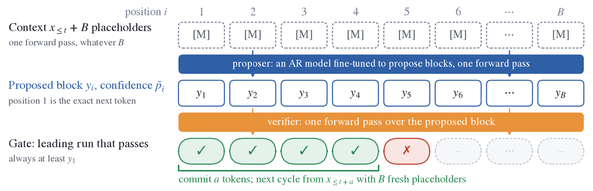
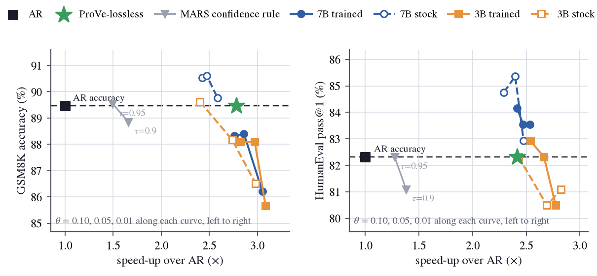

# ProVe: Proposer-Verifier Decoding

Speculative decoding lets a small model draft tokens one at a time and a large model check
them in parallel. **ProVe reverses the roles.** A large autoregressive model is fine-tuned into
a **proposer** that writes a **proposed block** of 16 tokens in a *single* forward pass; a
**verifier** then reads the whole block in *one more* forward pass and commits the longest
prefix it accepts. The verifier is a knob. With a smaller stock AR model as the verifier
(Qwen2.5-3B/7B-Instruct, gate p̃·q ≥ θ) you get **ProVe**, a controllable speed/accuracy
trade-off. With the proposer verifying its own block you get **ProVe-lossless**, whose output
equals the proposer's greedy AR decoding token for token. No separate draft head is trained.
With a 32B proposer, ProVe-lossless reaches 2.5× AR throughput on average over six benchmarks
(4.0× on BBH), and ProVe with a 3B verifier reaches 2.7× at −2.6 accuracy points.

<p align="center"></p>

*One ProVe cycle. The proposer predicts a block of candidate tokens from placeholders in one
forward pass; a second pass verifies the proposed block before the next cycle begins. In ProVe
a smaller AR model decides how much of the block to commit; in ProVe-lossless the proposer
verifies its own block and supplies the greedy correction at the first disagreement.*

## Quick start (inference only)

Three steps on one CUDA 12.x GPU (toolkit with `nvcc` included). Memory, as estimated from the
serving stack's formula: the 7B proposer alone fits about 24 GB, the 7B proposer with a 3B
verifier about 40 GB; the paper's measured setting is the 32B proposer on two 80 GB GPUs
(`--tp 2`). The memory table, every `serve.sh` option, diagnostics and troubleshooting are in
[inference/README.md](inference/README.md).

**1. Install** (Python 3.12 environment `prove`, torch cu129, the bundled SGLang fork):

```bash
git clone https://github.com/Xalp/ProVe.git && cd ProVe/inference
bash setup_env.sh          # creates a Python 3.12 env "prove" (uv if present, else conda) and runs install.sh
# or, into an environment you already have:
bash install.sh            # torch 2.9.1 cu129 + pip install -e ./sglang + import check
```

Activate the environment afterwards (`source .venv-prove/bin/activate` for uv, `conda activate
prove` for conda). `install.sh` ends with `OK: ProVe, ProVeLossless and MarsThreshold are registered`.

**2. Download a proposer and a verifier** from the Hugging Face Hub:

```bash
hf download Xalphinions/MARS-Qwen2.5-7B-blk16 --local-dir models/MARS-Qwen2.5-7B-blk16   # 7B proposer
hf download Qwen/Qwen2.5-3B-Instruct --local-dir models/Qwen2.5-3B-Instruct              # verifier (ProVe only)
```

The verifier is any stock Qwen2.5-Instruct model that shares the proposer's tokenizer: the paper
uses 3B and 7B; `Qwen/Qwen2.5-0.5B-Instruct` is the smallest option for a quick test.
ProVe-lossless needs no verifier.

**3. Serve and benchmark.** `serve.sh` rewrites the checkpoint config (weights are linked, not
copied), writes the algorithm yaml, launches `sglang.launch_server` and prints
`READY http://127.0.0.1:<port>` once the server answers. The server speaks the normal SGLang /
OpenAI-style HTTP API.

```bash
# ProVe-lossless: the proposer verifies its own block; output == greedy AR
bash serve.sh --proposer models/MARS-Qwen2.5-7B-blk16 --port 30000

# ProVe with a 3B verifier (theta 0.10 / 0.05 / 0.01: lower = faster, lossier)
bash serve.sh --proposer models/MARS-Qwen2.5-7B-blk16 \
              --verifier models/Qwen2.5-3B-Instruct --theta 0.05 --port 30001

curl -s http://127.0.0.1:30000/v1/chat/completions -H 'Content-Type: application/json' -d '{
  "model": "default", "temperature": 0, "max_tokens": 256,
  "messages": [{"role": "user", "content": "A train travels 60 km in 45 minutes. What is its speed in km/h?"}]}'
```

To measure the speed-up yourself, serve the same weights as plain AR and as ProVe-lossless and
run `bench/quick_bench.py` against both (GSM8K questions, one request at a time, greedy):

```bash
# AR baseline, same weights, GPU 0
CUDA_VISIBLE_DEVICES=0 MARSV_LOG=1 bash serve.sh --proposer models/MARS-Qwen2.5-7B-blk16 --algorithm ar --port 30000
python bench/quick_bench.py --port 30000 --tokenizer models/MARS-Qwen2.5-7B-blk16 --n 50 --save ar.jsonl

# ProVe-lossless, GPU 1 (or stop the first server and reuse GPU 0)
CUDA_VISIBLE_DEVICES=1 MARSV_LOG=1 bash serve.sh --proposer models/MARS-Qwen2.5-7B-blk16 --port 30001 --log serve_30001.log
python bench/quick_bench.py --port 30001 --tokenizer models/MARS-Qwen2.5-7B-blk16 --n 50 \
       --save lossless.jsonl --compare ar.jsonl --server-log serve_30001.log
```

The second run reports tokens per second, the fraction of outputs identical to the AR run
and the accepted tokens per cycle from the server log. Do not expect every output to be
byte-identical: the block path and the AR path run different kernels, and at a near-tie token
their bf16 logits can pick different winners, after which the two continuations differ. In our
check (40 GSM8K prompts, 512 new tokens) 28 of 40 outputs were identical for the 7B proposer
and 29 of 40 for the 32B; the paper therefore compares task accuracy, not byte identity. Both
runs generate up to 1024 new tokens per prompt, the paper's cap. With the 7B proposer on GSM8K,
this repository's stack measured 433 vs 234 tok/s (1.85×) at 6.13 accepted tokens per cycle
(`eval/run_eval.sh` on `gsm8k_cot`, greedy, one request at a time, 1024 new tokens); that 7B
experiment is not reported in the paper, whose tables use the 32B proposer.

## Checkpoints

| checkpoint | role | where |
|---|---|---|
| `MARS-Qwen2.5-7B-blk16` | 7B proposer (Qwen2.5-7B-Instruct, block size 16); the 7B numbers below | [`Xalphinions/MARS-Qwen2.5-7B-blk16`](https://huggingface.co/Xalphinions/MARS-Qwen2.5-7B-blk16) |
| `MARS-Qwen2.5-7B-AR-SFT` | its stage-1 AR checkpoint (AR baseline, or `STAGE2_INIT` for training) | [`Xalphinions/MARS-Qwen2.5-7B-AR-SFT`](https://huggingface.co/Xalphinions/MARS-Qwen2.5-7B-AR-SFT) |
| 32B proposer | Qwen2.5-32B-Instruct + Dolci, block size 16; the paper's main proposer | release pending |
| verifiers | stock `Qwen/Qwen2.5-3B-Instruct`, `Qwen/Qwen2.5-7B-Instruct` | Hugging Face Hub |

Any MARS block-16 checkpoint is a valid proposer; `train/` reproduces the 32B one.

## Results

Single request in flight, greedy, 1024 new tokens, speed-ups against greedy AR decoding of the
same proposer on the same hardware (32B proposer served with TP=2). Six benchmarks: HumanEval,
GSM8K, GPQA, BBH, MMLU-Pro, IFEval; "Avg" is their unweighted mean.

| proposer | configuration | verifier | speed-up vs AR | accuracy |
|---|---|---|---|---|
| 32B, 6 benchmarks | **ProVe-lossless** | proposer itself | **2.54× avg** (1.43× IFEval … 3.98× BBH) | exact (= AR, 72.6 avg) |
| 32B | ProVe, θ = 0.10 | Qwen2.5-3B-Instruct | 2.28× | −1.1 points |
| 32B | ProVe, θ = 0.05 | Qwen2.5-3B-Instruct | 2.49× | −1.6 |
| 32B | ProVe, θ = 0.01 | Qwen2.5-3B-Instruct | **2.72×** | −2.6 |
| 32B | ProVe, θ = 0.05 | Qwen2.5-7B-Instruct | 2.30× | −0.2 |
| 32B | MARS self-gate, τ = 0.95 (`--algorithm mars-tau`) | none | 1.48× | −0.9 |
| 32B | EAGLE-3 head fine-tuned for the proposer, tree of 60 [a] | — | 2.58× | exact |
| 32B | speculative decoding, 3B draft, k = 5 [a] | — | 1.63× | exact |
| 7B (public), GSM8K [b] | ProVe-lossless | proposer itself | 1.85× (433 vs 234 tok/s), 6.13 accepted tokens/cycle | 75.1 vs 74.4 |

[a] From the paper; not reproducible with this repository: `serve.sh` has no speculative /
EAGLE-3 mode and the fine-tuned EAGLE-3 head is not released. The paper ran them on the same
sglang stack with `--speculative-algorithm STANDALONE --speculative-draft-model-path <3B>
--speculative-num-steps 5 --speculative-eagle-topk 1 --speculative-num-draft-tokens 6
--mem-fraction-static 0.68` and `--speculative-algorithm EAGLE3 --speculative-draft-model-path
<head> --speculative-num-steps 8 --speculative-eagle-topk 10 --speculative-num-draft-tokens 60`
(plus `--context-length 8192`); these flags can be passed after `serve.sh --algorithm ar --`.
[b] Measured with this repository (`eval/run_eval.sh`, GSM8K, greedy, single request, 1024
new tokens); not reported in the paper. The other rows are Table 1 of the paper.

<p align="center"></p>

*Speed against accuracy on GSM8K (left) and HumanEval (right), 32B proposer. Square: AR; star:
ProVe-lossless; grey triangles: the MARS confidence rule; each curve is ProVe with one verifier
at θ ∈ {0.10, 0.05, 0.01}, dashed for the stock verifier and solid for a verifier trained on
the proposer's outputs (the trained verifiers are not part of this release).*

## Train your own proposer

A proposer is an ordinary instruction-tuned model after two stages of fine-tuning with the
public [MARS](https://github.com/Xalp/MARS) code: AR SFT on Dolci, then block training
(block size 16) on a 12.5 % subset. [train/README.md](train/README.md) gives the exact recipe,
hyper-parameters and GPU hours (150 + 384 on 32 GPUs for the 32B proposer);
`train/train_proposer.sh` runs it on one 8-GPU node or across nodes.

## Evaluate

[eval/README.md](eval/README.md) reproduces Table 1 of the paper: `eval/run_eval.sh` serves one
configuration and runs the 45 lm-evaluation-harness units of the six benchmarks through a timed
backend, so accuracy and tokens per second come from the same generations;
`eval/aggregate.py` prints the tables and the speed-ups.

## Repository layout

```
inference/          everything an inference-only user needs
  serve.sh            one command: prepare checkpoint, write yaml, launch sglang, wait until ready
  install.sh, setup_env.sh, requirements-lock.txt
  configs/            prove_lossless.yaml, prove_3b_theta{0.10,0.05,0.01}.yaml, prove_7b_theta0.05.yaml, mars_tau0.95.yaml
  tools/prepare_checkpoint.py   MARS (a2d) config -> qwen2 config, weights linked not copied
  bench/quick_bench.py          tok/s, accepted tokens per cycle, AR-vs-ProVe identical-output check
  sglang/             the SGLang fork; ProVe lives in sglang/srt/dllm/ (see sglang/PROVE_CHANGES.md)
train/              train_proposer.sh, DeepSpeed/accelerate configs, prepare_dolci_subset.py
eval/               run_eval.sh, lmeval_sgl.py (sgl_timed backend), aggregate.py, tasks.txt
assets/             figures used in this README
```

## Acknowledgements

* The inference stack is a fork of [SGLang](https://github.com/sgl-project/sglang) taken from
  [I-DLM](https://github.com/Introspective-Diffusion/I-DLM), whose block-decoding serving path
  ProVe builds on.
* Proposers are trained with [MARS](https://github.com/Xalp/MARS).
* Evaluation uses [lm-evaluation-harness](https://github.com/EleutherAI/lm-evaluation-harness)
  (the [fork pinned by MARS](https://github.com/ZHZisZZ/lm-evaluation-harness)).

## Citation

```bibtex
@article{jin2026prove,
  title   = {ProVe: Proposer-Verifier Decoding},
  author  = {Jin, Ziqi and Li, Jiaxi and Zhong, Yujie and She, Qi and Xu, Weiwen and Sun, Aixin},
  journal = {arXiv preprint arXiv:TBD},
  year    = {2026}
}
```

## License

ProVe's code is released under the Apache License 2.0 ([LICENSE](LICENSE)). The bundled SGLang
fork is Apache-2.0 and the I-DLM additions it contains are BSD-3-Clause; see
[THIRD_PARTY_NOTICES.md](THIRD_PARTY_NOTICES.md).
